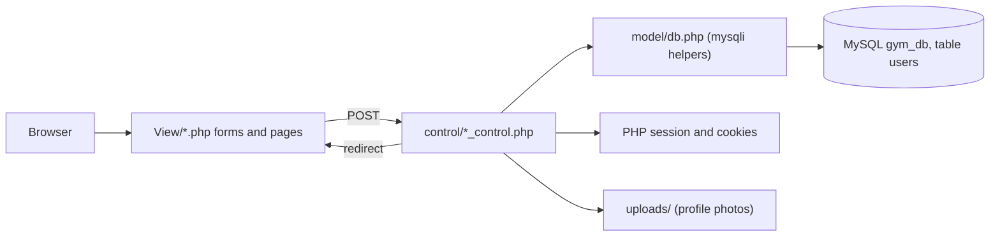
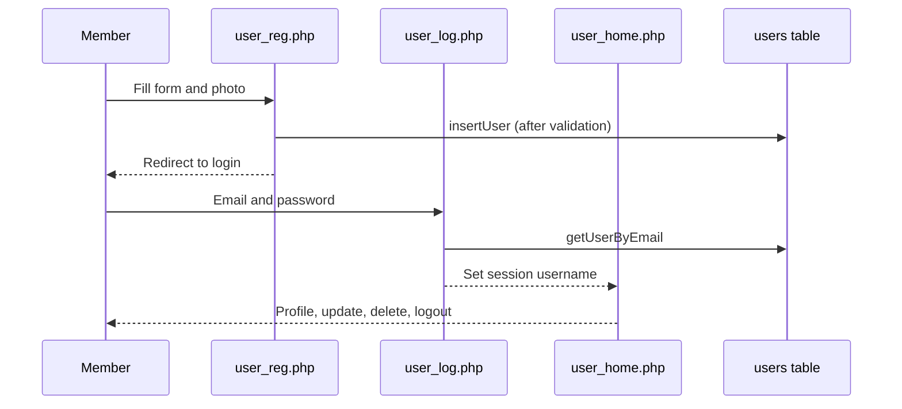

<div align="center">
  

  <p><code>A PHP and MySQL MVC gym member portal with session login, profile uploads and account management, built as an AIUB web course project.</code></p>

  <p>
    <a href="https://github.com/Saji-d/spark-powerhouse-gym-web"></a>
    
    <a href="LICENSE"></a>
  </p>
  <p>
    
    
    
    
    
    
  </p>

  <p>
    <a href="#-overview">Overview</a> ·
    <a href="#-highlights">Highlights</a> ·
    <a href="#-preview">Preview</a> ·
    <a href="#-architecture">Architecture</a> ·
    <a href="#-tech-stack">Tech Stack</a> ·
    <a href="#-getting-started">Getting Started</a> ·
    <a href="#-project-structure">Structure</a> ·
    <a href="#-roadmap">Roadmap</a> ·
    <a href="#-author">Author</a>
  </p>
</div>


## ◈ Overview

Spark Powerhouse Gym is a small web application where a gym member can register, log in, see a personal home page, view and edit a profile, upload a profile photo and delete the account. It is organised as Model, View and Control folders in plain PHP with a MySQL back end.

This is an **academic web technology project** that simulates a gym platform at a concept level. It has **no payments, no external APIs and no admin panel**: the only role is the member. For simplicity it stores passwords as plain text and builds SQL by string concatenation, so it is a teaching exercise and not something to deploy.

A companion desktop version of the same idea lives in [spark-powerhouse-gym-csharp](https://github.com/Saji-d/spark-powerhouse-gym-csharp).


## ◈ Highlights

<table>
  <tr>
    <td width="33%" valign="top"><b>Registration</b><br>Username, email, password, phone, birthday, gender, address, membership (basic, standard or premium), trainer choice and workout days.</td>
    <td width="33%" valign="top"><b>Two-layer validation</b><br>Regex checks in JavaScript in the browser and again in the PHP controller.</td>
    <td width="33%" valign="top"><b>Session login</b><br>PHP sessions guard every member page; unauthenticated visits get an access-denied message.</td>
  </tr>
  <tr>
    <td valign="top"><b>Profile photo upload</b><br>Images are stored in <code>uploads/</code> with a timestamp prefix and shown on the profile.</td>
    <td valign="top"><b>Update and delete</b><br>Members can change phone, address, membership and photo, or remove their account.</td>
    <td valign="top"><b>Welcome cookies</b><br>A cookie remembers the visitor so the home page can greet them back.</td>
  </tr>
</table>


## ◈ Preview

<div align="center">
  
  <br>
  <sub>Concept cover art for the project. The running app is a plainer set of PHP pages styled by <code>css/style.css</code>.</sub>
</div>


## ◈ Architecture

Views post to controllers, controllers call helpers in `model/db.php`, and the model talks to the MySQL database `gym_db` through `mysqli`.






## ◈ Tech Stack

| Layer | Technologies | Purpose |
| --- | --- | --- |
| Back end | PHP (procedural, MVC-style folders) | Controllers, sessions, cookies, file uploads |
| Database | MySQL through `mysqli` | `gym_db` database with a `users` table |
| Front end | HTML, CSS (`css/style.css`), JavaScript (`js/validation.js`) | Pages, styling and client-side validation |
| Local server | XAMPP or any Apache, PHP and MySQL stack | Run the app on `localhost` |


## ◈ Getting Started

**Prerequisites:** XAMPP (or similar) with Apache and MySQL running.

```bash
git clone https://github.com/Saji-d/spark-powerhouse-gym-web.git
# place the folder inside htdocs, for example C:/xampp/htdocs/spark-powerhouse-gym-web
```

The repository does not ship a SQL file, so create the database by hand. `model/db.php` connects to `localhost` as the default local user to a database named `gym_db` and expects a `users` table with these columns:

```text
user_name, email, password, birthday, gender, address,
phone, membership, trainer, workout_days, photo
```

Then open the app in a browser:

```text
http://localhost/spark-powerhouse-gym-web/View/index.php
```

Register a member, log in and explore the profile pages. The `uploads/` folder must be writable by Apache.


## ◈ Project Structure

<details>
<summary>Show folder tree</summary>

```text
spark-powerhouse-gym-web/
├── View/        index, user_reg, user_log, user_home, user_data, user_update, user_delete, user_logout
├── control/     one controller per view (registration, login, update, delete and more)
├── model/       db.php with connection and user queries
├── css/         style.css
├── js/          validation.js
├── uploads/     sample profile photos
├── LICENSE
└── README.md
```

</details>


## ◈ Roadmap

- [x] Registration with validation, session login and profile pages
- [x] Profile photo upload, update and account deletion
- [ ] Hash passwords with `password_hash` and verify with `password_verify`
- [ ] Switch to prepared statements to prevent SQL injection
- [ ] Add an SQL schema file to the repository
- [ ] Add an admin role and a real dashboard
- [ ] Fix the `../view/` redirect so it matches the `View/` folder on case-sensitive servers


## ◈ Author

**Sajidur Rahman Sajid**: Full-Stack Developer and AI engineer from Dhaka. BSc in CSE at American International University-Bangladesh (AIUB).

<p>
  <a href="https://www.sajidur.me"></a>
  <a href="https://www.linkedin.com/in/sajidur-rahman-sajid/"></a>
  <a href="https://github.com/Saji-d"></a>
  <a href="mailto:sajidsajidurrahman99@gmail.com"></a>
</p>

<sub>A web technology course project, shared as it was built. Released under the MIT licence.</sub>
